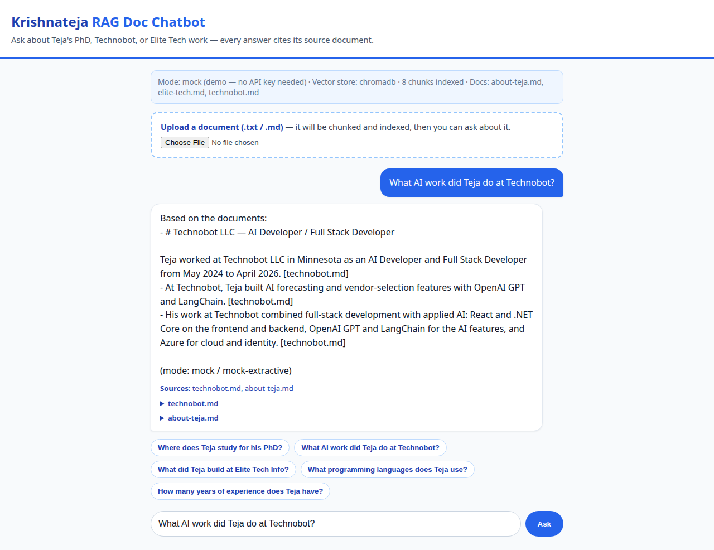

# Krishnateja RAG Chatbot — Product 1

A working **RAG (Retrieval-Augmented Generation) doc chatbot**, built to learn
by building. Ask it about Krishnateja's PhD, Technobot, and Elite Tech work — every
answer cites the source document it came from.

This is Product 1 of 3 in Krishnateja's 60-day plan to get an AI job in 1–2 months:
Product 2 is a LangGraph agentic workflow, Product 3 is a PhD research
paper agent — reads a pile of papers, summarizes them, finds
contradictions, and builds a literature review outline with citations.
All three projects are kept open source.

> **Runs with NO API key.** In demo/mock mode the pipeline works end-to-end
> (chunk → embed → retrieve → answer with citations) using a local mock
> embedding + extractive answering. Add an OpenAI or Azure OpenAI key and the
> same code calls a real LLM instead — no code change needed.

## Demo

Screenshot of the working app (mock mode, no API key) — asked "What AI work
did Krishnateja do at Technobot?" and the answer cites `technobot.md` and
`about-teja.md`:



## Live demo

Deploy this repo on Render as a free web service (the `render.yaml` at the
repo root already defines it — no code change needed):

**https://krishnateja-rag-chatbot.onrender.com**

Runs in mock mode with no API key. Note: the free tier sleeps after
15 minutes of inactivity, so the first load after a pause can take
30–60 seconds while the service wakes up. Uploaded documents are kept
only in memory/ephemeral storage on the free tier, so they do not
survive a restart.

## Folder structure

```
krishnateja-rag-chatbot/
├── backend/
│   ├── main.py        # FastAPI app: /health, /chat, /upload, /documents, /
│   ├── rag.py         # The RAG pipeline: chunking, embeddings, vector search, answering
│   └── eval.py        # Eval runner: loads eval/eval_set.json, checks accuracy + citations
├── eval/
│   └── eval_set.json  # 8 eval questions, each with a known answer + expected source doc
├── scripts/
│   └── eval.py        # Preferred eval entry point (thin wrapper over backend/eval.py)
├── frontend/
│   └── index.html     # Single-page chat UI (served by FastAPI at /)
├── data/
│   └── sample_docs/   # Sample documents — Krishnateja's own public facts only
│       ├── about-teja.md
│       ├── technobot.md
│       └── elite-tech.md
├── requirements.txt
├── .env.example       # Copy to .env — never commit real keys
└── README.md
```

## Run it (5 minutes)

```bash
cd krishnateja-rag-chatbot
python3 -m venv .venv && source .venv/bin/activate
pip install -r requirements.txt

# Demo mode (no key needed):
python -m uvicorn backend.main:app --reload --port 8000

# Then open http://localhost:8000
```

Try these questions in the UI (or with curl):
- "Where does Krishnateja study for his PhD?"
- "What AI work did Krishnateja do at Technobot?"
- "What did Krishnateja build at Elite Tech Info?"

```bash
curl -s http://localhost:8000/health
curl -s -X POST http://localhost:8000/chat \
  -H 'Content-Type: application/json' \
  -d '{"question": "What AI work did Krishnateja do at Technobot?"}'
```

## Run the eval

```bash
python scripts/eval.py
# or: python backend/eval.py
# Expected in demo mode: 8/8 passed, accuracy 100%, citation correctness 100%.
# Writes eval_results.json.
```

The eval set (`eval/eval_set.json`) is 8 questions, each with a known
correct answer and an expected source document, taken verbatim from the
sample docs. A question passes only when **both** hold:

1. **Accuracy** — every expected keyword is in the answer text (a partial
   answer fails: "SQL Server" without "MongoDB" is wrong).
2. **Citation correctness** — the *expected* source is both returned in
   `sources` and cited in the answer text as `[file.md]`. Citing the wrong
   document fails even if the keywords are right.

| # | Question | Expected answer | Source |
|---|----------|-----------------|--------|
| 1 | Where does Krishnateja study for his PhD? | University of the Cumberlands | about-teja.md |
| 2 | What AI work did Krishnateja do at Technobot? | AI forecasting and vendor-selection with OpenAI GPT and LangChain | technobot.md |
| 3 | What did Krishnateja build at Elite Tech Info? | ServiceNow portals and IT asset management workflows | elite-tech.md |
| 4 | What programming languages and frameworks does Krishnateja use? | Python, JavaScript, React.js, Java, C#, .NET Core, Spring Boot, SQL | about-teja.md |
| 5 | How many years of experience does Krishnateja have? | 4+ years | about-teja.md |
| 6 | When did Krishnateja work at Technobot? | May 2024 to April 2026 | technobot.md |
| 7 | Who did Krishnateja report to at Elite Tech Info? | Satyam B | elite-tech.md |
| 8 | What databases did Krishnateja work with at Technobot? | SQL Server and MongoDB | technobot.md |

The eval caught real bugs while it was built: Q8 first failed because the
stemmer turned "databases" into "databas", so query expansion never fired
and the SQL Server sentence was never picked; the old eval would have
passed anyway because it only checked that *some* citation existed.

## Use a real LLM (optional)

```bash
cp .env.example .env
# Edit .env and set OPENAI_API_KEY=...  (or the AZURE_OPENAI_* values)
# Restart the server. /health will now show mode: "openai" (or "azure").
```

Never put a key in the code, in git, or in a screenshot. `.env` is git-ignored.

## What each part teaches — read the code in this order

### 1. Python + FastAPI — `backend/main.py`
A REST API with Pydantic models (`ChatRequest` / `ChatResponse`), so bad
input is rejected with a clear error instead of crashing. Endpoints are
small and single-purpose: `/health`, `/chat`, `/upload`, `/documents`.
**Learn:** how a chat product's backend is structured, and how the frontend
talks to it over HTTP/JSON.

### 2. Chunking — `backend/rag.py: chunk_text()`
Documents are split into ~500-character chunks with 50 characters of
overlap, using LangChain's `RecursiveCharacterTextSplitter` (with a plain-
Python fallback). Overlap matters: a fact split across a boundary is lost.
**Learn:** why RAG never sends a whole document to the LLM, and how chunk
size / overlap change retrieval quality. The sizes were chosen by
experiment, not guesswork: on the 8-question eval, 500/50 and 800/100 both
score 8/8, but 500/50 keeps 1–3 paragraphs per chunk so citations stay
precise, while 800/100 merges whole docs into 4 chunks. 300/30 drops to
7/8 — the SQL Server/MongoDB sentence loses its surrounding context.
Try changing `CHUNK_SIZE` in `rag.py`, re-run `scripts/eval.py`, and see
what happens.

### 3. Embeddings — `backend/rag.py: Embedder`
Each chunk becomes a vector. Real mode uses OpenAI / Azure OpenAI
embeddings. Demo mode uses a deterministic hash-based mock embedding —
explicitly labelled as *not* a real semantic embedding — so the pipeline
can be tested for free. In demo mode retrieval also re-ranks by keyword
overlap, so answers stay grounded.
**Learn:** what an embedding is for (similarity search), and why the
embedding model and the LLM are two separate calls with two separate costs.

### 4. Vector search + mock-mode ranking — `backend/rag.py: VectorStore`, `_rerank_by_keywords()`
ChromaDB stores chunks + vectors persistently in `data/chroma_db/`, so the
index survives restarts. If ChromaDB is unavailable, an in-memory store
with cosine similarity is used instead — same interface, same citations.
**Learn:** how retrieval works (query → vector → nearest chunks), and how
to swap a vector store without rewriting the rest of the app.

In mock mode the hash embeddings are a weak signal, so retrieved chunks
are re-ranked by keyword overlap — but not by counting words equally.
Three things make the ranking work:

- **IDF weighting** (`_idf_weights()`): a word in every chunk ("teja",
  IDF ≈ 1.25) is worth far less than a word in one chunk ("cumberlands",
  "satyam", "mongodb", IDF ≈ 2.5). The old equal-weight ranking let a
  chunk score just for saying "Krishnateja" and outrank the chunk with the answer.
- **Stemming + whole-word matching** (`_stem()`, `_tokens()`): "build"
  matches "built", "reported" matches "report", and "ai" no longer matches
  "available" by substring.
- **Query expansion** (`QUERY_EXPANSIONS`): a question word that never
  appears in the docs still retrieves — "databases" expands to "sql",
  "mongodb", "server", so "What databases did Krishnateja work with at
  Technobot?" finds the "worked with SQL Server and MongoDB" sentence.

One more fix in the same area: `VectorStore.add()` now upserts changed
chunks and deletes stale ones instead of skipping ids that already exist.
Before, editing a doc or changing the chunk size left the old chunks in
ChromaDB forever, because the persistent index was never updated.

### 5. RAG prompting — `backend/rag.py: RAGChatbot.ask()`
Retrieve top-3 chunks, then prompt the LLM: *"Answer using ONLY the
context below. If the context does not contain the answer, say 'I don't
know based on the documents provided.' Cite the source file for each fact."*
**Learn:** grounding is a prompt discipline, not a model property. The
same LLM hallucinates without context and stays honest with it.

### 6. Citations — `backend/rag.py: Answer.sources` + `frontend/index.html`
Every answer returns its source chunks, and the UI shows them as
expandable source cards. An answer without a citation is treated as a
failure in the eval. In mock mode the returned sources are exactly the
files the answer text cites — previously every retrieved chunk's file was
listed, so a PhD answer "cited" elite-tech.md even though no sentence
from it was used.
**Learn:** citations are a product feature (trust), not a decoration.
Recruiters and users both ask "where did that come from?"

### 7. Evals — `eval/eval_set.json` + `backend/eval.py` (run: `scripts/eval.py`)
8 questions, each checked for (a) every expected keyword in the answer
and (b) the *expected* source cited in the answer text and returned in
`sources`. Run it after every change. A fluent but uncited — or
wrongly-cited — answer fails: that is the hallucination / misattribution
failure mode RAG exists to prevent. The extractive answerer also scores
sentences with the same IDF-weighted scheme as retrieval and keeps only
sentences scoring at least half as well as the best sentence, so filler
sentences from a retrieved chunk (e.g. "Krishnateja reported to Satyam B…"
inside an answer about his PhD) no longer ride along.
**Learn:** evals are how AI engineers work: test the system, don't just
demo it. Next step: add your own questions and expected keywords to
`eval/eval_set.json` — no code change needed.

## Stretch exercises (do these next)

1. **PDF upload:** add `pypdf` and extract text from uploaded PDFs in
   `/upload` (currently .txt/.md only).
2. **Better retrieval:** the current ranking is IDF-weighted keyword
   re-ranking with stemming and query expansion in mock mode. Try `top_k=5`,
   try a smaller chunk size, and compare eval scores — the eval records
   the chunk size in `eval_results.json`, so the comparison is written down.
   Next real step: swap the mock embedding for a local sentence-transformer
   embedding and see whether the eval still needs the keyword re-ranker.
3. **Real LLM eval:** set an OpenAI key, run `backend/eval.py`, and
   compare the answers with demo mode. Which answers got better? Which
   got worse?
4. **Streaming:** make `/chat` stream tokens (FastAPI `StreamingResponse`)
   so the UI shows the answer as it is generated.
5. **Azure:** set the `AZURE_OPENAI_*` variables in `.env` and run the
   same eval against Azure OpenAI + Azure AI Search concepts from the
   60-day plan.

## What this project proves (for recruiters)

- Python + FastAPI backend, clean REST API
- LangChain chunking, OpenAI/Azure embeddings, ChromaDB vector search
- RAG prompting with citations — grounded answers, not hallucinations
- Retrieval tuning: IDF-weighted re-ranking, stemming, query expansion,
  chunk-size experiments measured against the eval
- Evals — an 8-question set with known answers and expected sources,
  checking accuracy *and* citation correctness (8/8 in mock mode)
- A chat UI with source display and document upload

## Facts used in the sample docs

Only Krishnateja's own public facts: PhD in AI at University of the Cumberlands
(classes started May 2026, in progress); Technobot LLC, May 2024–Apr 2026,
AI forecasting / vendor selection with OpenAI GPT + LangChain, React +
.NET Core inventory app, Azure AD, real-time APIs, CI/CD; Elite Tech Info
Inc, Oct 2023–May 2024, ServiceNow portals / IT asset workflows, REST
APIs, SCCM/JAMF. No metrics, clients, or projects were invented.
